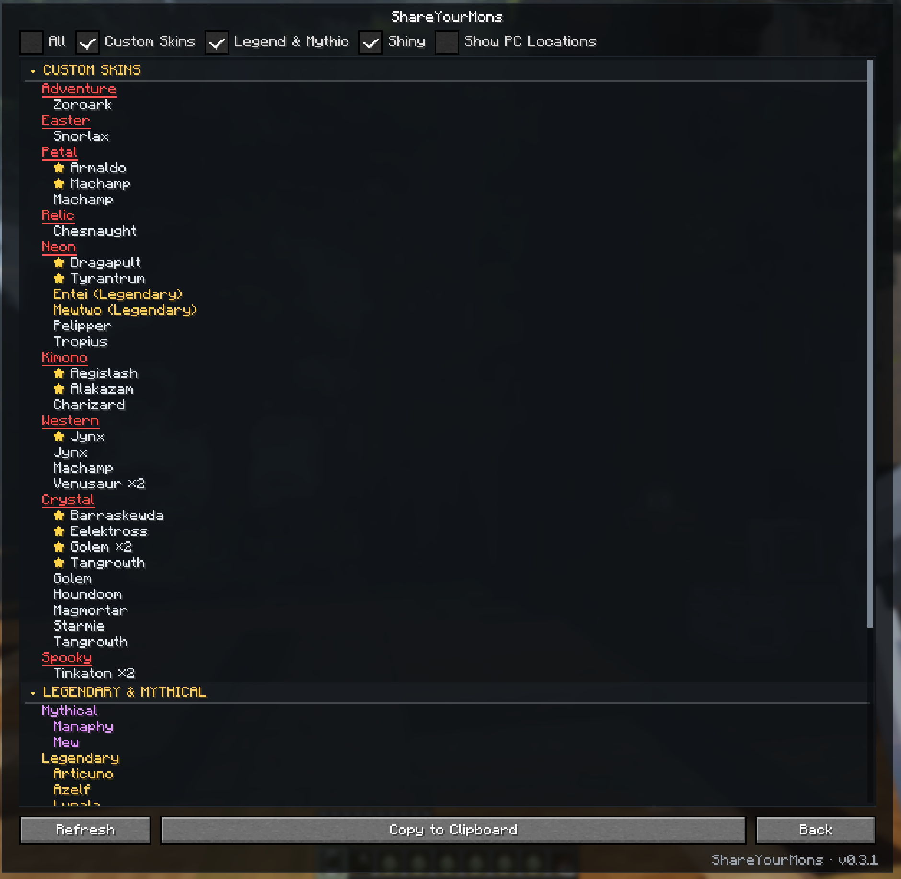

<h1> ShareYourMons</h1>

**See your entire Cobblemon collection in one place!**

ShareYourMons makes it easy to browse your Pokémon collection, find rare Pokémon and custom
skins, and copy your collection to share with friends.

This mod is designed exclusively for the [Cobblemon Town modpack](https://www.curseforge.com/minecraft/modpacks/cobblemon-optimized-your-pokemon-journey)
and server. Visit the [Cobblemon Town Wiki](https://cobblemon-town.gitbook.io/cobblemon-town)
to learn more.

## Features

- **Custom Skins:** See special Pokémon skins, organized by collection.
- **Legendary & Mythical:** Find Legendary and Mythical Pokémon.
- **Shiny Pokémon:** View Shinies in one place.
- **All Pokémon:** Browse every Pokémon stored in the PC.
- **PC Locations:** See which box and slot each Pokémon is in.
- **Copy to Clipboard:** Copy a list of the collection to share with others.
- **Refresh:** Update the collection list whenever needed.

## Installation

1. Install the latest version of the Cobblemon Town modpack.
2. Download ShareYourMons and place it in the `mods` folder.
3. Launch Minecraft.
4. Open the Escape menu and select **ShareYourMons** from the Swamp Mods launcher.

That’s it! No server installation or additional mods are needed beyond the modpack.

## Download

ShareYourMons is available from [GitHub Releases](https://github.com/SwampDad/shareyourmons/releases).
The CurseForge link will be added when the renamed build is published.

## License

ShareYourMons is open source and released under the [MIT License](LICENSE).
