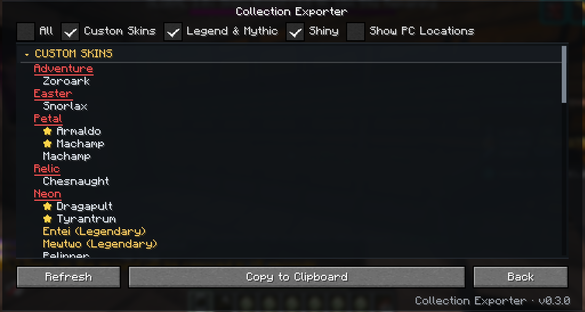

# Collection Exporter

Collection Exporter is a client-only, read-only Fabric mod for Minecraft 1.21.1. It reads
the Cobblemon PC data already synchronized to your client and builds a clear collection
report that you can browse in-game or copy to the clipboard for Discord and personal notes.

It is not an official Cobblemon Town or Cobblemon project.



## Features

- Native, scrollable collection viewer with compact category filters and collapsible sections.
- Custom Skins grouped by collection family, with shiny entries shown separately.
- Legendary and Mythical Pokémon split into clear groups; shiny, skin, and rarity labels
  remain visible when categories overlap.
- Independent **Show PC Locations** option. It expands grouped duplicates into their individual
  one-based `Box N, Pos. N` locations in both the viewer and copied report.
- Refresh reads the currently synchronized client PC again. Partial, unavailable, and ambiguous
  reads are explicitly identified rather than presented as a complete collection.
- Unknown aspects remain visible for review; unknown tokens are never automatically promoted to
  custom skins.
- A small bottom-right label always shows the installed mod version from Fabric metadata.

## Install

1. Use Minecraft `1.21.1`, Fabric Loader `0.18.0` or newer, Fabric API
   `0.116.7+1.21.1` or newer, Cobblemon `1.8.2`, and Java `21` or newer.
2. Download `collection-exporter-0.3.0.jar` from the
   [releases page](https://github.com/SwampDad/collection-exporter/releases).
3. Put it in the client instance's `mods` folder, ensuring only one Collection Exporter JAR is
   installed.
4. Restart Minecraft. No server installation, PC Plus, or PC Exporter is required.

## Use

Open the Minecraft Escape menu and choose **Collection Exporter** through the Swamp Mods
launcher. The default selection is **Custom Skins**, **Legend & Mythic**, and **Shiny**;
**All** is off. Filters use logical OR, so a Pokémon matching multiple selected categories is
included once and shown under the priority Custom Skins → Legend & Mythic → Shiny → Other.

Use **Show PC Locations** when you need each stored instance's location. Use **Copy to Clipboard**
to copy the same categorized report currently represented by the viewer.

### Example copied report

This representative excerpt is intentionally truncated:

```text
━━━━━━━━━━━━━━━━━━━━━━━━━━━━━━━━━━━━━━━━━━━━
               COBBLEMON TOWN
             Pokémon Collection
━━━━━━━━━━━━━━━━━━━━━━━━━━━━━━━━━━━━━━━━━━━━
October 22, 2026 · 5:17 PM EDT
PC Snapshot: Complete
CUSTOM SKINS
────────────────────────────────────────────
  Adventure
    Zoroark
  Easter
    Snorlax
  Petal
    Shiny Armaldo
    Shiny Machamp
    Machamp
  Relic
    Chesnaught
  Neon
    Shiny Dragapult
    Shiny Tyrantrum
    Entei (Legendary)
    Mewtwo (Legendary)
    Pelipper
    Tropius
...
```

## Privacy and behavior

- Client-only: the server does not need this mod.
- Read-only: it does not send packets, issue commands, mutate Pokémon/storage/inventory, or
  automate gameplay.
- It has no telemetry, account upload, or file-export behavior.
- Reports are generated locally and copied only when you select **Copy to Clipboard**.
- A complete snapshot means the client-synchronized store was fully traversed; it is not a
  live server query or proof of current server ownership.

## Build from source

With JDK 21 or newer:

```sh
./gradlew clean test build
```

The remapped runtime JAR is written under `build/libs/`.

## License

Collection Exporter is released under the [MIT License](LICENSE). Source and releases live at
[SwampDad/collection-exporter](https://github.com/SwampDad/collection-exporter).
